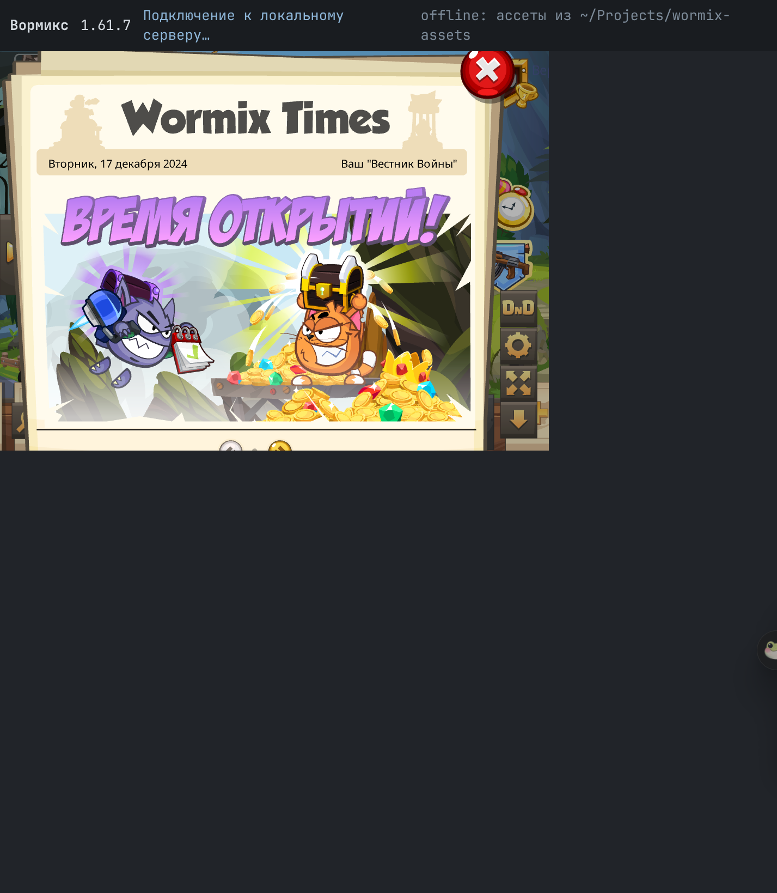

# arena-local — автономный локальный стенд Flash-клиента 1.61.7

Клиент (Flash/AS3, 1.61.7) целиком крутится на локальной машине: страница, ассеты,
звук и игровой сервер. Внешних обращений нет — сетевой слой отвечает записанной сессией.

## Что внутри

```
server.py        aiohttp: статика ассетов, /session, /api-заглушки, WS-«сервер» на replay
index.html       страница с Ruffle + urlRewriteRules + socketProxy
replay/*.bin     записанные ответы настоящего сервера (7-байтный заголовок + тело)
patched/         клиентские SWF с фиксами под Ruffle/1.61.7 с фиксами под Ruffle/1.61.7
avatar.png       заглушка аватарки для API-заглушки
```

Ассеты берутся из `~/Projects/arena-assets/swf/1.61.7` (симлинк `assets/`) либо из
каталога в переменной `ASSETS_DIR`.

## Запуск

```bash
ln -s ~/Projects/arena-assets/swf/1.61.7 assets   # если ещё нет
python3 -m pip install aiohttp
python3 server.py                                   # http://127.0.0.1:18371/
```

Открыть `http://127.0.0.1:18371/` в браузере с Ruffle. Через `agent-browser`:

```bash
agent-browser ensure arena-local http://127.0.0.1:18371/
agent-browser screenshot arena-local shot.png --focus   # --focus: Ruffle спит в скрытой вкладке
```



## Как это работает

1. `index.html` подменяет адрес CDN движка на локальные
   `/game/...` и `/storage/...` — клиент качает паки, локализацию и звук с диска.
2. `/session` отдаёт флешварсы с локальным `auth_key` и `api_url`.
3. `/api` отвечает на `users.get`, `getProfiles`, `getUserSettings`, `getAppFriends`
   заглушками, чтобы прелоадер не ходил в сеть.
4. `/socket/60101` — WebSocket-«игровой сервер»: читает кадры клиента
   (`Login`, `GetArena`, …) и отвечает заранее записанными кадрами
   (`10001 EnterAccount`, `10004 ArenaResult`, `10117`, `10124`, `10126`, `10116`, `10017`).

Проверенная последовательность (совпадает с онлайн-запуском):

```
клиент: 1 -> 136 -> 708 -> 117 -> 124 -> 126 -> 116 (+ ping 16)
сервер: 10001 -> 10004 -> 10117 -> 10124 -> 10126 -> 10116 -> 10017
```

Результат — полноценный вход и главное меню/лобби, отрисованные из локальных ассетов.

## Границы

* Это **replay**, а не эмуляция логики: сервер отдаёт записанные ответы, поэтому
  состояние статично (кошелёк, сундуки, списки — из записи).
* Бои/переходы в локации требуют серверной логики и `storage/levels/map*.swf`,
  которых в выгрузке нет — лобби и меню работают, матч не стартует.
* Кадры записи содержат данные тестового аккаунта (`viewer_id 145085`).

## Оговорка

Локальный стенд для отладки собственных сценариев поверх клиента 1.61.7: наружу не
ходит, состояние берётся из записанной сессии.
